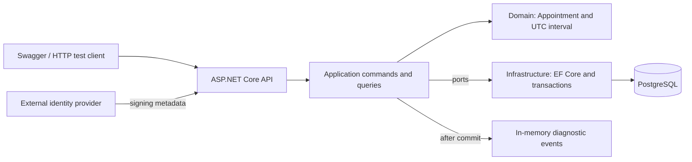

# Unified Service Scheduler — reviewer guide

**Scenario A, Part 2: backend implementation.** The API confirms an appointment
only when a qualified technician and a service bay cover the entire service
duration, then persists the customer, vehicle and allocated resources in PostgreSQL.

Swagger/OpenAPI and [HTTP examples](docs/api-demo.http) substitute for the client
layer. No frontend, simulator or Node installation is required.

## Setup and run the source

Prerequisite: **Docker with Compose v2**, running Linux containers. Run commands
from this repository's root. First startup requires internet access.

Start with one command:

```powershell
# Windows PowerShell
powershell -NoProfile -ExecutionPolicy Bypass -File scripts/start-reviewer.ps1
```

```sh
# macOS / Linux
bash scripts/start-reviewer.sh
```

The script generates local database passwords in an ignored `.env` file, then
builds and starts PostgreSQL 17.2, applies migrations, seeds synthetic records and
starts the API. No host database, .NET SDK or identity-provider account is needed.
Existing `.env` credentials and the database volume are preserved.

Open [Swagger](http://localhost:5080/swagger). Expand **POST /api/demo/auth**, click
**Try it out**, then **Execute**. The response contains three `accounts`: Admin
and two Customers, including their `accessToken`, customer/vehicle IDs and expiry.
Copy the Admin `accessToken` into Swagger **Authorize** (the token only), then call
**GET /api/demo/fixtures** to obtain booking scenarios. Use a Customer token to
verify ownership restrictions; each Customer can access only its mapped records.

Demo tokens last one hour. Request fresh tokens after expiry or API restart.
Business endpoints still validate JWT signatures, lifetime, roles and ownership.
This local token endpoint requires explicit reviewer authentication, Development,
demo mode and the allowlisted demo database. Keep this local demo bound to loopback;
it intentionally lets the local reviewer obtain test identities.

For subsequent runs use the same startup script. `docker compose down` stops the
stack while preserving data. Keep the same project directory/name and passwords.
Adding `--volumes` deletes the database; changing `.env` does not rotate stored
credentials. PostgreSQL has no published port; the API binds to loopback. Change
`REVIEWER_API_PORT` in `.env` if 5080 is occupied.

Troubleshoot with `docker compose ps -a` and `docker compose logs db migrate seed api`.
Migration failure blocks startup. To append fresh fixtures after consuming scenario
capacity, run `docker compose run --rm seed --seed-demo`, then request new demo
accounts and fixtures. Existing appointments remain stored.

### Use an external identity provider instead

Set `REVIEWER_AUTH_ENABLED=false` and configure `REVIEWER_JWT_AUTHORITY`,
`REVIEWER_JWT_ISSUER`, and `REVIEWER_JWT_AUDIENCE` in `.env`, then recreate the stack
with `docker compose down` followed by the startup script. Use your provider's HTTPS
metadata authority, exact issuer and API audience. Tokens need `sub` and a `role`
of `Admin` or `Customer`. Admin can use seeded customers immediately; Customer
access requires a trusted issuer/subject-to-CustomerId mapping in
`CustomerIdentityLinks`. The local token endpoint is absent in this mode.
Production continues to use external authentication; demo issuance cannot be enabled
in Production. Blank external JWT configuration fails closed with 401.

Manual Compose setup remains available: copy `.env.example` to `.env`, replace
password placeholders with different random alphanumeric values, then run
`docker compose up --build --wait --wait-timeout 180`.

## Run the assignment tests

### Docker-only tests (recommended)

Docker with Compose v2 and Linux containers is sufficient; no host .NET SDK,
PostgreSQL installation, `.env` or running demo API is needed. From the repository root:

```sh
docker compose -f compose.tests.yaml -p keyloop-scheduler-tests up --build --abort-on-container-exit --exit-code-from tests
```

This builds the test runner with .NET SDK 8.0.407, waits for isolated PostgreSQL
17.2, then runs unit and integration tests. The command returns the test runner's
exit code. Results are written to `artifacts/reviewer-compose-tests/` on your machine.
Tests host the API themselves and apply migrations only to their test database.

The test database publishes no ports and uses separate temporary storage. Its
fixed synthetic credential is only for this disposable test environment. The runner
shares its network namespace to preserve the tests' localhost-only database guard.
The application database and appointments are not used or modified.

After a run, remove the test containers before another fresh run:

```sh
docker compose -f compose.tests.yaml -p keyloop-scheduler-tests down
```

The temporary test database is discarded; exported TRX files remain. The demo stack
uses a different Compose project and can remain running. First-time image downloads
and package restore require internet access.

### Tests using a host .NET SDK (alternative)

Install **.NET SDK 8.0.407**, pinned in `global.json`. The test harness hosts the API
itself; the application stack above does not need to be running.

```sh
dotnet restore Keyloop.ServiceScheduler.sln
dotnet build Keyloop.ServiceScheduler.sln --no-restore
dotnet test tests/Scheduler.UnitTests --no-build --no-restore
```

Integration tests need a separate PostgreSQL 17.2 database. This PowerShell example
creates a local test-only container on **55433**, leaving the demo database untouched.
Use an unused container name; if that port is occupied, change all three port values.

```powershell
$env:POSTGRES_PASSWORD = [guid]::NewGuid().ToString('N')
docker run --name scheduler-reviewer-tests -d `
  -p 127.0.0.1:55433:5432 `
  -e POSTGRES_USER=scheduler_test -e POSTGRES_PASSWORD `
  -e POSTGRES_DB=keyloop_scheduler_test_reviewer postgres:17.2
docker exec scheduler-reviewer-tests pg_isready -h 127.0.0.1 -U scheduler_test -d keyloop_scheduler_test_reviewer
# Repeat pg_isready until it reports "accepting connections".
$env:SchedulerTests__PostgresPort = '55433'
$env:ConnectionStrings__SchedulerTestDb = "Host=127.0.0.1;Port=55433;Database=keyloop_scheduler_test_reviewer;Username=scheduler_test;Password=$env:POSTGRES_PASSWORD"
dotnet test tests/Scheduler.IntegrationTests --no-build --no-restore `
  --logger 'trx;LogFileName=integration.trx' --results-directory artifacts/reviewer-tests
```

The test-only bootstrap role owns this isolated database. The application Compose
stack uses a separate non-superuser app role. Tests migrate their own database,
use synthetic JWT keys with the real bearer handler, and exercise real PostgreSQL.
Missing configuration or a server-version mismatch fails the suite. The required
database name prefix is `keyloop_scheduler_test_`; never use the demo database.

Stop with `docker stop scheduler-reviewer-tests`; reuse with
`docker start scheduler-reviewer-tests` and the same credentials. The generated
password remains in this shell only; keep it privately if reusing the container
in another terminal. No automatic database deletion occurs.

Optional Docker setup checks (PowerShell and Docker only):

```powershell
powershell -NoProfile -ExecutionPolicy Bypass -File scripts/verify-reviewer.ps1
```

This uses an isolated Compose project on 5098, checks fresh/repeated startup and
failure handling, stops its containers and preserves its test volume.

## Client substitute: OpenAPI and HTTP examples

The running API exposes [OpenAPI JSON](http://localhost:5080/swagger/v1/swagger.json)
and [Swagger UI](http://localhost:5080/swagger). Editable requests, including
authentication, booking and readback, are in [api-demo.http](docs/api-demo.http).

With an Admin token, call `GET /api/demo/fixtures` for synthetic customer/vehicle
IDs and future timestamps. Use `scenarios.valid` for a booking or
`scenarios.noQualifiedTechnician` for an expected 409. Request fresh fixtures
when existing capacity has been consumed. Submit:

```http
POST /api/appointments
Authorization: Bearer <access-token>
Content-Type: application/json

{
  "customerId": "<fixture customer GUID>",
  "vehicleId": "<that customer's vehicle GUID>",
  "dealershipId": "<scenario dealership GUID>",
  "serviceTypeId": "<scenario service GUID>",
  "startsAt": "<scenario future timestamp with Z or numeric offset>"
}
```

Expect **201** and `Location`. Follow `GET /api/appointments/{id}`, restart the API,
and repeat that GET to verify persistence. The server chooses duration and resources.

| Route | Purpose |
| --- | --- |
| `GET /api/customers` | Admin-only customer lookup |
| `GET /api/customers/{id}/vehicles` | Admin or mapped Customer's vehicle lookup |
| `GET /api/dealerships`, `/api/service-types` | Dealership and service choices |
| `GET /api/availability?dealershipId=...&serviceTypeId=...&startsAt=...` | Advisory availability; reserves nothing |
| `POST /api/appointments` | Validate, allocate and persist |
| `GET /api/appointments/{id}` | Authorized persisted readback |
| `GET /api/appointments?customerId=...` | Authorized customer's bookings |

ProblemDetails errors include `code` and `traceId`: 400 invalid input, 401 invalid
identity, 403 denied scope/role, 404 unknown/concealed record, 409 unavailable
capacity, 503 database unavailable. Encode `+` in query timestamps as `%2B`.
After an uncertain POST outcome, inspect saved appointments before submitting again.

## Architecture diagram



This is runtime flow. Compile-time dependencies point inward: Application depends
on Domain; Infrastructure implements Application ports; API composes the service.
CQRS separates handlers while sharing one database.

## Source code structure and component description

| Path | Responsibility |
| --- | --- |
| `src/backend/Scheduler.Api` | Controllers, JWT/RBAC, middleware, ProblemDetails, Swagger and composition |
| `src/backend/Scheduler.Application` | Handlers, validation, ownership, DTOs and persistence/event ports |
| `src/backend/Scheduler.Domain` | Appointment aggregate, UTC interval and business invariants |
| `src/backend/Scheduler.Infrastructure` | EF mappings/migrations, allocation, transactions, seeding and events |
| `tests/Scheduler.UnitTests` | Domain rules and interval boundaries |
| `tests/Scheduler.IntegrationTests` | HTTP harness, security, database, concurrency, architecture and event checks |
| `docker`, `compose.yaml`, `Dockerfile` | Local database and API startup |
| `compose.tests.yaml`, `Dockerfile.tests`, `docker/tests/run-tests.sh` | Isolated Docker-only unit and PostgreSQL integration tests |
| `scripts/verify-reviewer.ps1` | Docker lifecycle acceptance checks |
| `docs/api-demo.http` | Client-side request examples |

## Documentation folder guide

For a review, start with [system design](docs/system-design.md), then read the
[backend architecture contract](docs/backend-architecture.md) and
[verification summary](docs/verification.md). Use the HTTP examples to exercise
the API. This README remains the entry point for current setup and test commands.

```text
docs/
  system-design.md
  backend-architecture.md
  verification.md
  api-demo.http
  auth-test-data.md
  agent-team/
    PROJECT.md
    ORCHESTRATOR.md
    TASK_TEMPLATE.md
    VERIFICATION_TEMPLATE.md
    runs/
      scenario-a-scope-correction/
      backend-architecture-definition/
      backend-architecture-implementation/
      reviewer-documentation/
      reviewer-simple-setup/
      reviewer-compose-tests/
```

| Document | Meaning and reviewer use |
| --- | --- |
| [system-design.md](docs/system-design.md) | System overview, component responsibilities, data flow, design rationale and operational tradeoffs. Follow its current implementation sections; older baseline sections are identified as historical. |
| [backend-architecture.md](docs/backend-architecture.md) | Detailed architecture and testing contract: layer boundaries, CQRS, authorization, transactions and event behavior. |
| [verification.md](docs/verification.md) | Consolidated acceptance mapping, recorded test results, supporting evidence and outstanding limitations. Start here when assessing what was actually verified. |
| [api-demo.http](docs/api-demo.http) | Editable HTTP requests for authentication, booking and persisted readback against the running API. |
| [auth-test-data.md](docs/auth-test-data.md) | Synthetic identity/ownership fixtures and security test cases. This is a test specification, not a database seed or execution report. |
| [agent-team/PROJECT.md](docs/agent-team/PROJECT.md) | Project scope, constraints and implementation guidance for AI-assisted maintenance. |
| [agent-team/ORCHESTRATOR.md](docs/agent-team/ORCHESTRATOR.md) | Agent coordination and review workflow; optional background for reviewers. |
| [agent-team/TASK_TEMPLATE.md](docs/agent-team/TASK_TEMPLATE.md) and [VERIFICATION_TEMPLATE.md](docs/agent-team/VERIFICATION_TEMPLATE.md) | Reusable task and verification-report formats; templates are not executed evidence. |
| [agent-team/runs/](docs/agent-team/runs/) | Supporting records for individual work stages. Consult these for detailed decisions, findings and verification commands. |

Each run folder contains `analysis.md` (scope and findings), `plan.md` (assigned
work and checks), `status.md` (handoff state), and `verification.md` (recorded
checks, results and limits). A planned check is not proof that it ran. Earlier
run statuses describe that stage; use the consolidated verification summary for
the latest recorded result.

| Run folder | Evidence or context |
| --- | --- |
| [scenario-a-scope-correction](docs/agent-team/runs/scenario-a-scope-correction/) | Interpretation of the assessment and selection of the backend layer. |
| [backend-architecture-definition](docs/agent-team/runs/backend-architecture-definition/) | Architecture analysis and planning before implementation. |
| [backend-architecture-implementation](docs/agent-team/runs/backend-architecture-implementation/) | Backend changes, independent review, provider/security tests and concurrency corrections. |
| [reviewer-documentation](docs/agent-team/runs/reviewer-documentation/) | Reviewer-guide changes and associated review/test results. |
| [reviewer-simple-setup](docs/agent-team/runs/reviewer-simple-setup/) | Local startup, reviewer authentication, restart persistence and migration failure guards. |
| [reviewer-compose-tests](docs/agent-team/runs/reviewer-compose-tests/) | Latest recorded Docker-only test execution: 28 unit and 159 integration tests passed on October 30, 2026. |

The AI collaboration narrative is in [AI-Usage.md](AI-Usage.md) at the repository
root. Exported test results, such as TRX files, are under `artifacts/` rather than
`docs/`.

## Data flow

1. Validate JWT and enforce role/record ownership.
2. Validate customer/vehicle, dealership, service and an offset-bearing future start.
3. Derive the end from stored duration and normalize timestamps to UTC.
4. Find a qualified technician and bay at the dealership covering the entire interval
   within their availability and opening hours.
5. Lock and recheck a candidate pair in a transaction, insert the appointment and commit.
6. Dispatch noncritical in-memory events after commit and return confirmation.

Availability GET is advisory; POST revalidates. Demo dealerships use
`Asia/Ho_Chi_Minh`, 08:00–17:00 daily. One technician and one interchangeable bay
serve an appointment. Confirmed intervals are immutable; cancellation/rescheduling
and schedule editing are outside this implementation.

## Key technical decision — concurrency control

Read-then-insert alone can double-book. PostgreSQL enforces **two independent GiST
exclusion constraints**: technician/time and bay/time. Both use `[start,end)` ranges,
allowing adjacent bookings and rejecting positive overlap. `btree_gist` supplies
equality support for resource IDs.

Each attempt uses a Read Committed transaction. Transaction-scoped advisory locks
acquire resources in consistent order, followed by an eligibility recheck, to avoid
competing allocation deadlocks. Constraints remain authoritative for other writers.
Known conflicts try remaining pairs with a fresh context/transaction; unknown commit
outcomes are not automatically retried. All associations commit atomically.

Resource schedules/qualifications are read-only in this version; editing them needs
additional consistency rules. In-memory events can be lost on process termination
and are never used for mandatory booking state.

## Technology choices

| Technology | Reason |
| --- | --- |
| .NET 8 / ASP.NET Core | Typed model, DI, middleware, JWT and HTTP testing |
| EF Core 8.0.11 / Npgsql provider 8.0.11 | Relational mapping, migrations and PostgreSQL transactions |
| PostgreSQL 17.2 | ACID persistence and range exclusions across API instances |
| DDD / Clean Architecture | Domain rules independent from HTTP/persistence |
| CQRS handlers, one database | Separate reads/writes without distributed consistency |
| In-memory dispatcher | Noncritical after-commit notifications without broker infrastructure |
| xUnit / WebApplicationFactory | Domain, HTTP/security and real-provider tests |
| Docker Compose | Setup without a pre-existing database or host SDK |

## Observability strategy

`docker compose logs api` shows structured request/booking logs with trace
correlation, outcome and elapsed time, excluding credentials and personal payloads.
`/health/live` checks the process; `/health/ready` checks database/schema readiness.

The `Scheduler.Booking` Meter exposes `scheduler.bookings` by outcome,
`scheduler.booking.duration` (ms) and `scheduler.booking.diagnostic_failures`.
The same-named ActivitySource emits booking/persistence spans. .NET listeners can
consume them; no collector/exporter is configured. Tests attach listeners to verify
instrumentation. Production monitoring would track conflicts, errors, latency and
database health before tuning allocation queries and indexes.

## AI usage during the design phase

The user selected scope, stack, DDD/Clean Architecture, CQRS, external JWT, RBAC
and transaction requirements. AI assisted with acceptance mapping, component
boundaries, interval/concurrency reasoning and test planning. Independent review
and provider tests exposed defects, including allocation deadlocks and post-commit
error risks, which were corrected and retested.

The detailed collaboration narrative and prior workflow context are in
[AI-Usage.md](AI-Usage.md). Human ownership includes identity configuration,
review of generated changes and the final demonstration recording.

## Quality assurance

Coverage includes duration/ownership validation, full-interval availability,
qualification, adjacency/overlap, independent resource exclusions, concurrent
allocation, persistence/rollback, JWT/RBAC, architecture boundaries and event failures.

Latest local verification (2026-10-30): the Docker-only test command completed
successfully, with unit tests **28/28 passed** and integration tests **159/159
passed** against PostgreSQL 17.2. Exported TRX reports survived test-container
cleanup. Independent review found no blocking defects. See
[verification details](docs/agent-team/runs/reviewer-compose-tests/verification.md).
Local checks do not imply a remote CI run. CI runs backend
build/tests and retains TRX evidence; it requires database repository secrets.
