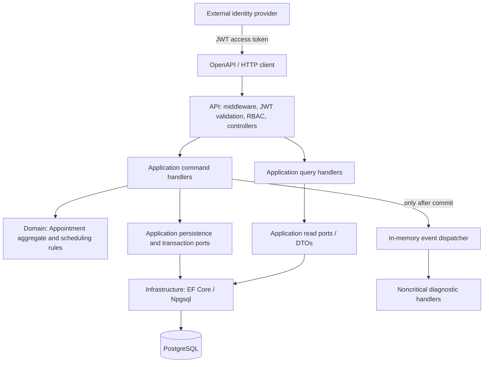
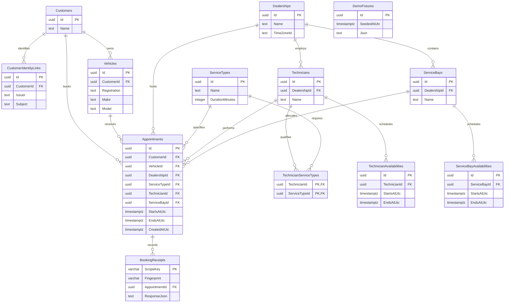

> Setup revision (2026-10-29): reviewer setup includes an explicitly enabled
> Development-only local signed-JWT issuer for fixed synthetic Admin/Customer
> accounts and generated database credentials. This supersedes the earlier blanket
> exclusion of local token issuance for reviewer testing only. Production retains
> external JWT authentication. Evidence: docs/agent-team/runs/reviewer-simple-setup/.

# Backend architecture and testing contract

Status: implemented; final local verification and limitations tracked in agent-team/runs/backend-architecture-implementation/. Updated 2026-10-28.
User-selected additions to Scenario A: DDD, Clean Architecture, CQRS, in-memory
event bus, .NET 8, EF Core, JWT/RBAC, validation, middleware, error handling,
logging and relational PostgreSQL with ACID transactions. These extend the PDF
requirements; backend remains the only assessed implementation layer.

## Architecture boundary

Use one deployable scheduling service and one relational PostgreSQL database.
CQRS separates code paths, not databases. No event sourcing, broker, microservices,
generic repository framework or mediator package is required. Keep existing project
names and compatible EF Core 8 / Npgsql 8 packages; select additions only with a
concrete need. Preserve existing .NET 8 and PostgreSQL version constraints pending
an explicit environment compatibility decision.

Arrows above show runtime flow. Compile-time dependencies are Domain -> none;
Application -> Domain; Infrastructure -> Application/Domain; API -> Application
and Infrastructure for composition only. Controllers must not use DbContext or
implement business logic. Domain has no EF, ASP.NET, claims or logging dependencies.

## DDD and Clean Architecture responsibilities

Bounded context: Service Scheduling. Use shared language: appointment, service
duration, qualification, resource availability and dealership. Appointment is the
booking aggregate root, retaining customer/vehicle/dealership/service/resource IDs
and the confirmed interval. Create it through invariant-preserving behavior rather
than arbitrary public mutation. Represent the UTC half-open service interval as a
value object; require positive duration and preserve the booked end timestamp.

Customer, Vehicle, ServiceType, Technician and ServiceBay are separately identified
reference/resource entities; do not load the whole dealership as one aggregate.
Aggregate boundaries do not by themselves prevent simultaneous resource allocation.
Use domain rules for eligibility and database constraints for cross-booking overlap.
Schedules and qualifications remain immutable after seeding for this version.

| Existing project | Target responsibility |
| --- | --- |
| Scheduler.Domain | Aggregate behavior, value objects, full-duration/qualification rules, domain event records |
| Scheduler.Application | Command/query handlers, validators, current-user abstraction, ownership policies, narrow persistence/read/transaction/event ports |
| Scheduler.Infrastructure | EF mappings, migrations, PostgreSQL constraints, port implementations, in-memory dispatcher implementation |
| Scheduler.Api | HTTP contracts, JWT validation/RBAC policies, middleware, ProblemDetails, composition and OpenAPI |

Move orchestration currently in Infrastructure/SchedulingService into Application
incrementally. Keep provider SQL and constraint error inspection in Infrastructure;
translate expected constraint conflicts into application results. Reuse current
BookingRules and tests rather than reimplementing proven interval behavior.

## CQRS and transaction flow

- Command: BookAppointment. Commands perform business changes and own a unit of
  work through an Application transaction abstraction implemented by Infrastructure.
- Queries: CheckAvailability, GetAppointment, ListAppointments and reference lookups.
  Queries project read-only DTOs, preferably no-tracking, and never reserve resources.
- Both paths use the same database. Query DTOs are separate from tracked aggregates.
  A small typed handler interface and DI suffice; no requirement for MediatR.
- Execution: authenticate -> authorize role -> validate input -> resolve current
  customer and ownership -> compute interval -> check eligibility -> create aggregate
  -> persist -> commit -> dispatch noncritical event -> return confirmation.
- Within each booking attempt, perform authoritative checks and insertion in one
  transaction. Retry only known capacity races with a fresh transaction/context and
  fresh aggregate/event collection; bounded attempts must consider alternate pairs.
  Cooperating allocators acquire transaction-scoped PostgreSQL advisory locks for
  the candidate bay and technician in consistent order, then recheck eligibility.
  A candidate consumed while waiting causes a fresh attempt. The independent
  exclusion constraints remain authoritative for writers that bypass these locks.
  Do not add a second nested transaction in generic middleware or a handler wrapper.
- Query availability remains advisory. POST must recheck and may return 409 even
  after GET reported availability. Do not automatically retry uncertain POSTs.

If commit acknowledgement fails, the outcome may be unknown: do not claim rollback,
dispatch an event or retry the booking automatically. Report a sanitized failure
with trace correlation and reconcile against persisted state. A known successful
commit is never converted into a booking failure by subsequent diagnostic work.

## JWT, RBAC and resource authorization

Confirmed choice: an external identity provider issues access tokens; the API
validates them. No local login, password storage, token issuance or refresh endpoint.
Configure trusted authority/issuer, audience, signing-key discovery and explicit
subject/role claim mappings. Require signature, issuer, audience and lifetime
validation. Fail closed for invalid/missing configuration; use HTTPS for real token
transport and metadata. Never accept unsigned tokens or trust a decoded payload.

Initial roles are an explicit design assumption: Customer and Admin. Use policy
names in controllers and enforce equivalent ownership constraints in Application
handlers. Enforce authentication and allowed roles there too through the trusted
current-user abstraction; direct handler invocation must not bypass authorization.

| Operation | Customer | Admin |
| --- | --- | --- |
| Dealership/service lookup and advisory availability | Allowed | Allowed |
| Book appointment | Own mapped customer and owned vehicle only | Book for specified existing customer; validate vehicle ownership |
| Read/list appointments or customer vehicles | Own records only | All customers in this single-organization demo |
| List customers | Forbidden | Allowed |
| Demo fixtures | Forbidden | Development + demo enabled only |
| Liveness | Anonymous minimal response | Same |
| Readiness | Anonymous minimal ready/unready status; no database/schema details | Same |

Map verified `(issuer, subject)` to a Customer through trusted persisted mapping,
with a unique issuer/subject pair. No mapping is a 403 for customer operations.
Never accept role or identity mappings from booking input. Preserve customerId in
the current POST shape for compatibility, but require it to match the authenticated
Customer mapping; Admin may select an existing customer. Missing/invalid JWT -> 401;
authenticated wrong role or supplied customer mismatch -> 403; another customer's
individual record read -> 404 to avoid confirming existence. Customer list queries
are always filtered to the mapped customer; an explicit foreign customer filter
is rejected with 403. Role authorization alone is insufficient for ownership.

For Customer booking, resolve the vehicle inside the mapped customer's scope:
foreign and nonexistent vehicle IDs both return the same sanitized 404. Admin
booking retains 400 for an existing vehicle belonging to a different selected
customer. A Customer reading another customer's vehicle collection receives 404,
matching a nonexistent collection; an explicit foreign appointment-list filter
remains 403. Check caller scope before querying foreign records. This intentionally
tightens the former anonymous demo's 400 vehicle-mismatch contract for Customers.
Admin operations do not require a Customer mapping; a token with both initial
roles follows the Admin policy. Unknown roles grant no access to protected routes.

Require one unambiguous nonempty subject claim for protected access; missing or
conflicting subject claims fail authentication (401). Customer-role lookup and
availability queries need no customer mapping because they expose shared reference
data; booking and customer-scoped reads require a mapping (403 if absent). Keep
the existing required customerId filter for appointment lists. HTTP authentication
and role authorization precede binding/validation; after valid binding, validate
shape before ownership and database checks. Do not query records for invalid IDs.

Identity-provider product, issuer/audience values and role claim names are deployment
configuration inputs, not reasons to add an identity server. Integration tests use
locally signed synthetic JWTs with real bearer validation and isolated test keys.
Preserve Development-only seed mode and its database safeguards. Seeding identity
links must be explicit; never auto-provision an Admin from arbitrary token claims.
This role matrix is single-organization scope, not a multi-tenant authorization claim.

The identity-link table has required issuer, subject and CustomerId, a unique
(issuer, subject) key and a Customer FK. Compare issuer/subject exactly; do not
lowercase subjects or substitute email as identity. No role is accepted from request
input. Explicit trusted setup owns mapping creation; no public mapping endpoint.
Required database configuration must also fail closed: remove the current embedded
fallback credentials during implementation, without copying their values into docs.

## Validation, middleware, errors and logging

Use HTTP binding validation for malformed JSON/types and Application validators for
command/query shape, IDs and explicit timestamp offsets. Domain protects invariants;
database constraints are the final persistence safeguard. Database-dependent rules
run in the authoritative use case, not only in a preflight validator.
Use existing validation patterns; FluentValidation is optional, not mandated.

Freeze these initial ProblemDetails `code` values: invalid_request (400),
unauthenticated (401), forbidden (403), not_found (404), no_capacity (409),
internal_error (500), dependency_unavailable (503). Field validation uses an
`errors` object mapping camelCase request fields to arrays of sanitized messages.
Concealed and nonexistent resources use the same code/title/detail shape, apart
from trace IDs. Minimal health responses remain the explicit exception to the
ProblemDetails contract. Known dependency unavailability maps to 503; unexpected
storage failures remain 500, requiring an intentional update to the existing
unreachable-database test. Neither is a capacity 409.

Pipeline: outer correlation/request logging and exception handling -> HTTPS handling
and routing -> configured CORS -> authentication -> authorization -> endpoints.
Exception handling covers downstream failures; authentication precedes authorization.
Do not create custom middleware duplicating built-in JWT or authorization services.

Use consistent ProblemDetails with status, stable error code and traceId; validation
responses also identify fields. 400 invalid request, 401 invalid identity, 403 denied
policy/ownership, 404 unknown or concealed record, 409 no capacity, 500 unexpected
error, 503 unavailable dependency/readiness. Preserve appropriate bearer challenge
headers. Do not expose exceptions, SQL or credentials in HTTP responses. Known
resource exclusion conflicts alone map to booking 409; other DB errors stay errors.

Use structured ILogger logs for request outcome/duration, trace ID and booking
result. Avoid tokens, Authorization headers, connection strings, VINs and personal
payloads. Preserve ActivitySource spans and Meter metrics; use low-cardinality metric
labels, not user IDs. No mandatory external logging or telemetry platform.

## In-memory event bus semantics

Appointment may collect AppointmentConfirmed as a domain event with event ID,
appointment ID and timestamp. Publish only after successful commit; discard pending
events on rollback and failed allocation attempts. Use an awaited, sequential,
in-process dispatcher with explicit handler registration and scoped dependencies.
Do not use fire-and-forget tasks or claim durable/exactly-once delivery.

Initial subscribers perform only noncritical diagnostic work. Handler failures are
caught and logged per handler; continue other subscribers. A committed booking must
remain successful even if a subscriber fails. Use a bounded dispatch budget independent
of a disconnected request; timeout/cancellation must not pretend the commit rolled back.
Dispose the booking transaction/context before subscriber execution. Treat subscriber
resolution and dispatcher failures as noncritical too. The dispatch budget covers
the full subscriber sequence; once exhausted, skip remaining subscribers and log
the outcome. Await active handlers to finish cooperatively; cancellation is not a
hard execution deadline for a noncooperative handler. Do not abandon tasks using
scoped dependencies. Test the registered diagnostic handlers' cancellation behavior.
Use a configurable total budget with a one-second initial default, explicitly a
diagnostic-work assumption rather than a guaranteed response-time SLA.
Handlers must honor cancellation and avoid blocking work. A process crash after commit
can lose the event, and no restart replay is promised. Event IDs support future deduplication,
not a current durability guarantee. No automatic subscriber retry in this version.

All required booking state and mandatory audit data, if introduced, must be saved
in the booking transaction. Do not depend on this bus for reservations, essential
notifications, security decisions or durable projections. If durable delivery later
becomes required, specify a transactional outbox and idempotent delivery separately.

## PostgreSQL ACID contract

| Property | Implementation and verification |
| --- | --- |
| Atomicity | One transaction commits required booking writes together; injected persistence failure leaves no partial records/events |
| Consistency | Required FKs/NOT NULL/positive interval checks, ownership/qualification rules and separate bay/technician exclusion constraints protect valid state |
| Isolation | Explicit Read Committed baseline plus PostgreSQL exclusion constraints protects overlap across requests/processes; read-then-insert alone is insufficient |
| Durability | Commit before success; keep normal durable PostgreSQL settings (fsync and synchronous_commit enabled); read back after app restart |

Preserve `[start,end)` timestamptz exclusions and btree_gist migration. EF Core is
the data-access layer, not the source of ACID guarantees. ACID does not make the
in-memory bus durable. Read Committed does not prevent every anomaly; immutable
seeded schedules/qualifications are an explicit assumption. Future resource editing
requires revisiting locking/isolation. Never disable durability settings for tests
claimed as production-like evidence. App restart tests prove persistence, not power-loss
recovery; do not claim storage hardware, failover or disaster-recovery validation.

### Persisted tables

The following 13 application tables reflect `SchedulerDbContext` and the current
schema definitions in `Scheduler.Infrastructure/Migrations`. PostgreSQL identifiers
use the exact names below. EF Core also maintains `__EFMigrationsHistory` as schema
metadata; it is not a business entity.

| Table | Purpose | Keys, relationships and constraints |
| --- | --- | --- |
| `Customers` | Customer records | PK `Id`; parent of vehicles, identity links and appointments |
| `CustomerIdentityLinks` | Map a verified JWT identity to a customer | PK `Id`; FK `CustomerId`; unique `(Issuer, Subject)` with case-sensitive `C` collation |
| `Vehicles` | Vehicles owned by customers | PK `Id`; FK `CustomerId`; alternate key `(Id, CustomerId)` supports booking ownership enforcement |
| `Dealerships` | Service locations and local time zones | PK `Id`; parent of technicians, bays and appointments |
| `ServiceTypes` | Services and server-owned durations | PK `Id`; check `DurationMinutes > 0` |
| `Technicians` | Technicians assigned to dealerships | PK `Id`; FK `DealershipId`; alternate key `(Id, DealershipId)` |
| `ServiceBays` | Bays assigned to dealerships | PK `Id`; FK `DealershipId`; alternate key `(Id, DealershipId)` |
| `TechnicianServiceTypes` | Explicit technician qualifications | Composite PK `(TechnicianId, ServiceTypeId)`; FKs to both reference tables |
| `TechnicianAvailabilities` | Dated technician availability windows | PK `Id`; FK `TechnicianId`; positive interval check; index `(TechnicianId, StartsAtUtc, EndsAtUtc)` |
| `ServiceBayAvailabilities` | Dated bay availability windows | PK `Id`; FK `ServiceBayId`; positive interval check; index `(ServiceBayId, StartsAtUtc, EndsAtUtc)` |
| `Appointments` | Confirmed bookings with allocated resources and stored intervals | PK `Id`; customer, vehicle, dealership, service, technician and bay FKs; positive interval check; separate technician/bay overlap exclusions; index `(CustomerId, StartsAtUtc)` |
| `BookingReceipts` | Persist idempotency fingerprints and replay responses | PK `ScopeKey` (64-character maximum); required `Fingerprint` and `ResponseJson`; FK and nonunique index on `AppointmentId` |
| `DemoFixtures` | Synthetic fixture identifiers and scenario metadata | PK `Id`; `SeededAtUtc` index; serialized fixture payload in `Json` (PostgreSQL `text`); no relational FKs |

All declared foreign keys use restricted deletion. Appointment composite FKs
`(VehicleId, CustomerId)`, `(TechnicianId, DealershipId)` and
`(ServiceBayId, DealershipId)` enforce ownership and resource location. Qualification
and full availability-window coverage are application checks; there is no appointment
FK to a qualification or availability row. The two GiST exclusion constraints
`appointment_technician_no_overlap` and `appointment_bay_no_overlap` independently
reject intersecting `[StartsAtUtc, EndsAtUtc)` ranges for the same resource.
When idempotency is requested, its receipt and appointment commit in the same
transaction. `AppointmentId` is not unique in `BookingReceipts`, so the ERD shows
the database's one-to-many relationship rather than assuming one receipt per booking.

### Entity relationship diagram

The ERD shows persisted keys and scheduling fields. `PK` and `FK` identify primary
and foreign keys; each child has one required parent, while a parent can have zero
or more children. Composite appointment relationships are detailed above.
`DemoFixtures` is intentionally disconnected: IDs embedded in its payload are not FKs.

## Testing workflow and completion gates

1. Establish existing backend build/test baseline; record uncommitted work and actual
   failures. Inspect discovered project commands before running them.
2. Add focused failing tests for each change; unit tests use controlled clocks and
   cover domain invariants, validators, handler results and ownership policies.
3. Enforce assembly dependency rules with architecture tests: Domain independent;
   Application free of Infrastructure/EF/ASP.NET references; controllers use handlers.
4. Run integration tests using real PostgreSQL in a separate disposable test database.
   Apply migrations there. Cover success/readback, rollback, partial overlap, adjacency,
   independent resource exclusions, competing requests and alternative capacity.
5. Test real JWT validation: missing, malformed, expired, wrong issuer/audience/key,
   wrong role, unmapped subject, cross-customer read/write, and valid Customer/Admin.
   Verify routes, status/ProblemDetails/challenge headers and no data leakage.
6. Test event ordering after commit, no dispatch on rollback/retry losers, subscriber
   failure/timeout preserving booking success, and explicit absence of durable replay.
7. API smoke through OpenAPI/HTTP: authenticated booking, persisted GET and unavailable
   resource rejection. Run in CI with ephemeral test keys and PostgreSQL prerequisites.
   Capture exact commands/results; skipped provider cases are blocked, not passed.
8. Independent tester and constraint reviewer inspect the final integrated changes;
   fixes return to their owner. Repeat affected checks, not unrelated frontend work.

Existing root commands: `dotnet build Keyloop.ServiceScheduler.sln`,
`dotnet test tests/Scheduler.UnitTests`, and
`dotnet test tests/Scheduler.IntegrationTests`. They are execution targets here,
not claims of current success. Add architecture/auth/event tests to existing test
projects where practical; verify discovery and that provider tests actually ran.

## Incremental implementation order

Baseline and contract tests -> Domain invariants and Application CQRS/ports ->
Infrastructure transaction adapters -> JWT/RBAC and identity mapping -> validation/
middleware/error alignment -> after-commit event bus -> real-provider/security/event
verification -> docs/demo update. Keep one owner for migrations, shared contracts
and composition. Authentication intentionally changes previously anonymous endpoints;
update OpenAPI and HTTP examples in that slice. Optional clients can later acquire
tokens, but their UI work is not a backend completion gate.

## Technical references

- [ASP.NET Core JWT bearer validation](https://learn.microsoft.com/en-us/aspnet/core/security/authentication/configure-jwt-bearer-authentication?view=aspnetcore-8.0)
- [EF Core transactions](https://learn.microsoft.com/en-us/ef/core/saving/transactions)
- [PostgreSQL 17 transaction isolation](https://www.postgresql.org/docs/17/transaction-iso.html)

These references support framework behavior. Aggregate boundaries, role matrix,
CQRS shape and noncritical event policy are project design decisions.
