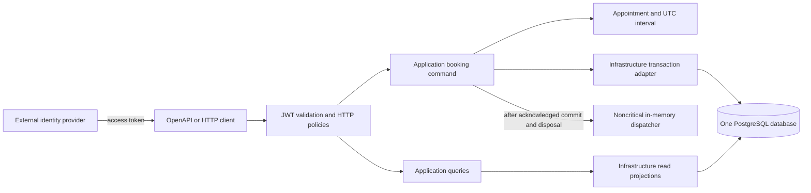
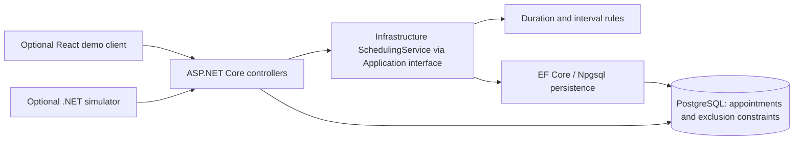

> Reviewer entry point: ../README.md contains the current architecture and setup.
> As of 2026-10-29, frontend and simulator source have been removed at the user's
> request. OpenAPI/HTTP examples are the client substitute. Older baseline sections
> below are retained as history; AI workflow context is in ../AI-Usage.md.

# System design — Unified Service Scheduler

## Target architecture — 2026-10-27

The current target is [backend-architecture.md](backend-architecture.md), including
its dependency diagram, DDD/Clean/CQRS boundaries, external JWT/RBAC policy matrix,
ACID/event semantics and staged testing workflow. These user-selected requirements
supersede demo identity and direct controller/EF access in the baseline below.
Implementation and final local verification are complete. The current run records executed checks and limitations separately from the original baseline below.

## Current backend implementation

The reviewer Docker path builds the API in a .NET SDK8.0.407 container and runs it
on ASP.NET8. Compose waits for PostgreSQL17.2 TCP readiness, runs explicit migrations,
then prepares reusable demo fixtures before the API starts. The app uses a separate
non-superuser database owner. A named volume persists across normal down/up cycles;
the database has no host port mapping. Setup commands retain Development/demo-name
guards. External JWT validation is unchanged; health and Swagger alone do not grant
access to business endpoints. See the README for local `.env` configuration.

The implementation keeps the original four projects and one PostgreSQL database.
Domain owns the immutable confirmed Appointment and UTC interval value object.
Application owns BookAppointmentHandler, CheckAvailabilityHandler, appointment and
reference queries, validation and ownership policies. Infrastructure implements
EF read projections, transaction attempts, readiness, database error classification
and the scoped in-memory dispatcher. Controllers call Application handlers; API
composes dependencies and handles HTTP authentication, authorization and errors.

The command authenticates/authorizes, validates shape, resolves trusted customer
scope, derives server duration and validates resource eligibility within an explicit
Read Committed transaction. Before inserting, it takes transaction-scoped PostgreSQL
advisory locks for the candidate bay and technician in consistent order, then checks
eligibility again. This serializes cooperating allocations sharing a resource and
avoids deadlocks between competing exclusion checks. Locks release with the attempt;
the exclusion constraints still protect against writers that do not take these locks.
Each stale candidate or known exclusion loser gets a new DbContext and
transaction, rechecks eligibility, and tries a remaining pair. The original bay and
technician exclusion constraints and composite association FKs remain authoritative.
Unknown commit acknowledgement failures are never retried automatically. Successful
state is independently readable before event dispatch. Failure or timeout in a
subscriber cannot reverse the booking; process termination can lose diagnostics.

Customer identity uses a required Customer FK and exact case-sensitive unique
issuer/subject pair. Admin does not require a Customer mapping. Customers cannot
select another customer's booking scope, and foreign/missing vehicle or appointment
IDs produce the same concealed404 response. Tokens are validated by the real JWT
bearer handler against configured HTTPS issuer metadata/signing keys, audience and
lifetime. No password/login/token-issuance service was added.

.NET8 and EF Core/Npgsql8 preserve the selected stack and existing mappings.
PostgreSQL is retained because its independent half-open range exclusions protect
both resources across concurrent connections. Code-level CQRS provides separate
read/write responsibilities without another database or eventual consistency.
Typed ports and ordinary DI avoid a mediator or generic repository framework.
The in-memory bus is deliberately restricted to noncritical diagnostics; mandatory
state belongs in the transaction. Resource schedules/qualifications are immutable
in this version, so Read Committed plus exclusions is sufficient for the stated
booking race, not a guarantee against every possible future editing anomaly.

Validation errors include field names, stable error codes and trace correlation.
Logs use route templates rather than raw paths/query strings and exclude tokens,
connection strings and personal payloads. Booking counters, duration histogram and
ActivitySource spans are preserved; diagnostic listeners are isolated from business
success. Instrumentation can be observed with local .NET diagnostic listeners;
no external telemetry platform is required. CI retains PostgreSQL17.2 and captures
TRX evidence; no remote CI execution is claimed by the local run.

Current execution evidence, review findings and remaining limitations are in
[the implementation verification record](agent-team/runs/backend-architecture-implementation/verification.md).
The earlier implementation baseline below is retained for provenance and does not
describe the new authorization/dependency boundaries.

## Existing implementation baseline (before architecture changes)

The assessed layer is the .NET 8 backend. OpenAPI/cURL supplies the minimal client substitute. Existing simulator and React clients are optional supporting tools. PostgreSQL stores confirmed appointments and protects resource intervals independently of any application process.

## Responsibilities and data flow
In the existing baseline, controllers query DbContext directly for reads and call IScheduler for booking. Infrastructure's SchedulingService validates references, vehicle ownership, server duration, business hours, qualification and full resource availability, then persists transactionally. Application currently contains contracts, not the target handlers. Domain defines interval rules but still has mutable entities and an EF Design package dependency. These are inspected implementation gaps; the target above moves responsibilities inward. Neither client writes directly to PostgreSQL.

Availability reads are advisory. Booking derives the end time from the stored service duration, enumerates eligible resources in deterministic ID order and inserts within a transaction. Independent GiST exclusion constraints reject overlaps for each technician and bay. Only known resource exclusion violations become retryable conflicts; each attempt uses a fresh transaction, and remaining capacity is tried before returning 409. Unexpected storage failures remain errors.

## Assumptions
Demo-selected customer IDs are not authenticated identity. Vehicle ownership is nevertheless validated. A future identity provider must map authenticated principals to customer IDs and restrict customer lookup/readback before production use. One technician and one interchangeable bay serve each appointment. Qualifications and schedules are read-only after seeding. Only confirmed appointments are persisted; cancellation and admin changes require a future consistency design.

Services have positive server-owned minute durations. Stored ends do not change when a service definition changes. All intervals use [start,end); offset-bearing timestamps normalize to UTC timestamptz. Asia/Ho_Chi_Minh dealerships open 08:00–17:00 daily. Explicit dated windows cover 14 days, and the entire service must fit both resource windows and opening hours. TimeProvider makes past-time validation testable.

## Reliability, performance and maintainability
The database provides the concurrency guarantee across API instances. Small bounded candidate scans and resource/time indexes support the demo; larger deployments should measure contention and query plans before introducing allocation optimizations. No process lock, distributed cache, broker or extra repository framework is required. Transactions prevent partial booking persistence. No client automatically retries a POST with an uncertain outcome.

The target layered dependencies make Domain independent and Application dependent only on Domain, with Infrastructure implementing application ports; the baseline has the exceptions noted above. .NET 8, EF Core 8 and Npgsql 8 preserve the requested stack. React and the simulator are optional HTTP clients.

## Fixture safety and verification
Explicit seed mode requires Development, Demo.Enabled and the exact demo database name; migrations are a separate command. Seeding adds isolated synthetic namespaces without clearing earlier records. Persistent metadata exposes scenario IDs and future times through a Development-only endpoint. Integration tests use a separately named disposable database; no cleanup touches demo data.

Real-provider checks must independently exercise both exclusions, persistence across fresh contexts/hosts, the existing single-pair race and two-pair alternative capacity. Twenty clients is the retained test configuration, not an assessment mandate. Historical reports observed PostgreSQL 17.4 against the requested 17.2 baseline; this design pass did not probe the server. Recheck the environment before implementation verification and resolve a mismatch explicitly if still present. Simulator suites remain optional.

## Observability
Use correlated structured logs containing result, trace/request ID, service/dealership IDs and elapsed time, without customer payloads or credentials. Meter counters cover confirmed/conflicting/failed bookings; a histogram captures duration. ActivitySource spans surround booking and persistence. Console logs are the initial operational view; metric/trace listeners can be attached locally. No mandatory external telemetry service.

## GenAI design assistance

For the architecture revision, the user selected .NET 8, DDD/Clean Architecture,
CQRS, in-memory events, JWT/RBAC and PostgreSQL ACID, then confirmed external token
issuance. The agent inspected existing source with a read-only analyst, separated
transactional booking state from lossy notifications, documented authorization and
testing boundaries, and requested independent review. The subsequent authorized
implementation added those boundaries and independent real JWT/PostgreSQL tests.
Review found postcommit diagnostic and cleanup risks, while executed tests exposed
authentication configuration and dependency-error classification defects. Corrections
and final executed results are recorded in the implementation run linked above.
The primary agent read the supplied rules and delegated read-only acceptance analysis to the configured spec_analyst, followed by a planner to freeze file ownership and contracts. The analyst identified lexical offset validation, separate exclusion-constraint tests, fixture expiry and independent readiness as explicit implementation concerns. Human-provided specifications fixed the backend-first strategy and technology choices. This document will be updated with actual implementation and review findings; proposed checks are not execution evidence.
